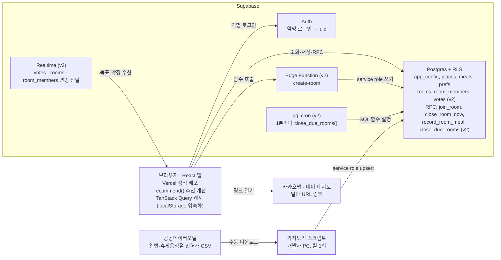
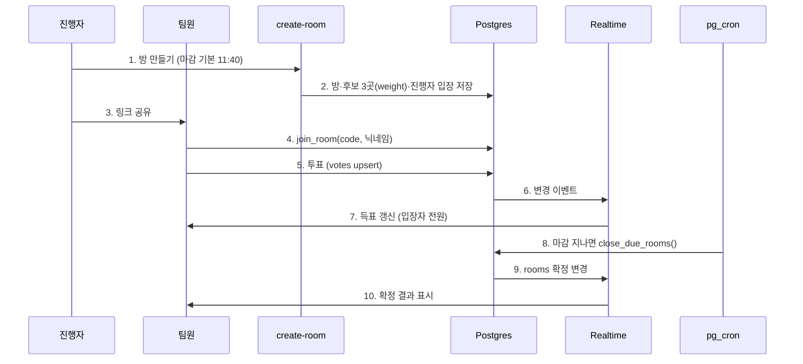

# 수내역 점심 룰렛 — 아키텍처

## 시스템 구성

서버를 직접 만들지 않고, 브라우저의 React 앱이 Supabase와만 통신하는 구조다. 식당 목록은 개발자가 공공데이터 CSV를 가져오기 스크립트로 넣고, 지도 서비스는 API 없이 링크로만 연결한다.



> 강조된 가져오기 스크립트만 `places`의 공공데이터 행을 쓴다. (v2) = 팀 투표 단계에서 추가.

브라우저는 anon 키로 RLS가 허용한 범위만 읽고 쓴다. 가져오기 스크립트는 개발자 PC에서 service role로 식당 목록을 갱신한다. v2의 Edge Function은 방을 만들고, 마감된 방의 확정은 pg\_cron이 DB 안의 SQL 함수로 처리한다. v1에는 Edge Function과 외부 API 키가 없다.

## 저장소와 프론트엔드 구조

저장소는 pnpm 워크스페이스 하나에 앱, 공용 로직, Supabase 설정을 함께 둔다. 추천 로직을 `packages/core`로 분리하는 이유는 브라우저와 Edge Function이 같은 코드를 쓰기 위해서다. 그래서 `packages/core`는 외부 의존성이 없는 순수 TypeScript로 작성하고, Deno에서도 읽을 수 있도록 상대 import에 `.ts` 확장자를 붙인다.

```
lunch-roulette/
├─ apps/web/                 # React + Vite
│  └─ src/
│     ├─ pages/              # Home, Places, History, Settings, RoomNew(/rooms/new), RoomVote(/r/:code, 지연 로딩)
│     ├─ features/
│     │  ├─ account/         # AccountSection(이메일 연결·로그인), useAuthSync(사용자 전환 시 캐시 초기화)
│     │  ├─ backdrop/        # SunaeBackdrop (three.js 잔상 배경, React.lazy로 별도 파일)
│     │  ├─ data/            # queries.ts (TanStack Query 훅: 세션·설정·식당·기록 조회와 저장)
│     │  ├─ roulette/        # RouletteWheel, ResultCard, FilterBar
│     │  ├─ places/          # AddPlaceForm, vocabulary.ts(카테고리·태그 어휘)
│     │  ├─ ui/              # Chip (공용 토글 칩)
│     │  ├─ tour/            # ProductTour(첫 방문 사용법 안내), placement.ts(밝힐 영역·카드 위치 계산)
│     │  └─ room/            # api.ts(미리보기·생성·입장·조회·투표·useRoomRealtime), realtime.ts(구독 뒤 다시 조회하는 시점), time.ts(마감 표시·카운트다운) (v2)
│     ├─ pages/History.tsx   # 기록 목록 + 30일 통계(core mealStats)
│     ├─ stores/             # filterStore(localStorage에 기억), rouletteSessionStore, tourStore(안내를 봤는지, localStorage에 기억) (Zustand)
│     ├─ lib/                # supabase.ts, queryClient.ts(영속화 설정), mapLinks.ts(카카오·네이버 링크)
│     └─ App.tsx
├─ packages/core/            # recommend.ts, cooldown.ts(영업일), weights.ts, geo.ts(거리·도보 시간), room.ts(방 후보·기본 마감) + 테스트
├─ scripts/import-places/    # 공공데이터 CSV → places (좌표 변환, 업태 매핑) + 테스트
└─ supabase/
   ├─ migrations/            # 테이블, RLS, RPC(join_room 등), pg_cron SQL
   └─ functions/             # (v2)
      ├─ deno.json           # @lunch/core → _shared/core
      ├─ _shared/core/       # packages/core 복사본 (pnpm functions:sync-core, git 제외)
      └─ create-room
```

**상태를 어디에 두는가**

| 상태 | 위치 | 예시 |
| --- | --- | --- |
| 서버 데이터 | TanStack Query 캐시 | 전역 설정, 식당 목록, 내 기록, 내 설정 |
| 화면을 넘나드는 UI 상태 | Zustand | 켜 둔 필터, 이번 세션에서 넘긴 식당, 첫 돌리기 시각과 돌린 횟수 |
| 한 컴포넌트 안 상태 | `useState` | 휠 회전 각도, 모달 열림 |
| URL | React Router | 방 코드(`/r/:code`), 카테고리 탭 |

이 구분이 React 학습 포인트이기도 하다. 서버에서 온 데이터를 전역 스토어에 복사하지 않고, 쿼리 캐시를 그대로 쓰는 것이 핵심이다.

## 핵심 흐름

**룰렛 (v1)** — 서버 호출은 처음 데이터를 받을 때와 기록을 저장할 때 두 번뿐이다.

1. 앱을 열면 TanStack Query가 `app_config`, `places`, `user_place_prefs`, 최근 30일 `meals`를 받아 캐시한다. 캐시는 localStorage에 남아 오프라인에서도 쓸 수 있다.
2. "돌리기"를 누르면 브라우저에서 `recommend()`가 걸러내기 → 가중치 → 가중 랜덤으로 1곳을 고른다. 휠에는 그 1곳과 가중치 상위 7곳(후보가 8곳보다 적으면 전부)을 표시하고, 결과 칸에서 멈추도록 회전 각도를 계산한다. 첫 돌리기 시각과 돌린 횟수는 Zustand 세션에 기록한다.
3. "다시 돌리기"는 그 식당을 Zustand의 세션 제외 목록에 넣고 2번을 반복한다. 후보를 모두 넘기면 "처음부터 다시"로 세션 제외 목록을 비운다.
4. "여기 갈래"는 `meals`에 `spin_count`, `decision_seconds`와 함께 upsert하고 쿼리 캐시를 무효화한 뒤, 사용자가 고른 지도 링크(카카오맵 또는 네이버 지도)를 연다. 오프라인이면 저장은 대기했다가 온라인 복귀 후 재시도한다.

**팀 투표 (v2)** — 팀원은 방에 입장한 뒤 DB에 투표 한 줄만 쓰고, 집계와 확정 결과는 Realtime이 갱신한다.



마감을 진행자 화면에 맡기지 않고 pg\_cron이 처리하므로, 진행자가 브라우저를 닫아도 방은 제시각에 확정된다(최대 1분 지연). 동점이면 방을 만들 때 저장한 `weight`가 큰 후보를 고르고, 0표인 방은 확정 없이 닫는다. 확정 결과는 투표한 사람의 기록에 남고, 그날 이미 개인 기록이 있으면 그 기록을 유지한다.

## 배포·환경 변수·비용

개인·팀 규모에서는 월 0원으로 운영할 수 있다. 프론트는 Vercel, 백엔드는 Supabase 무료 플랜이고, 공공데이터와 지도 링크는 무료다.

**배포 흐름**

1. `main` 브랜치에 푸시하면 Vercel이 `apps/web`을 빌드해 배포한다. PR마다 프리뷰 URL이 생긴다.
2. DB 변경은 `supabase/migrations`에 SQL로 남기고 `supabase db push`로 반영한다. `app_config` 초기값과 v2의 `pg_cron` 확장 활성화도 마이그레이션에 포함한다.
3. 식당 목록은 공공데이터포털에서 CSV를 내려받아 `pnpm import:places <파일 절대 경로>`로 넣는다(스크립트가 자기 패키지 폴더에서 실행되므로 절대 경로를 쓴다). 로컬 DB와 클라우드 DB 중 대상은 스크립트의 환경 변수로 정한다.
4. (v2) Edge Function은 `pnpm functions:deploy`로 배포한다. 함수 디렉터리 밖의 `packages/core`는 읽히지 않아서, 이 명령이 먼저 `_shared/core`로 복사한 뒤 `supabase functions deploy create-room`을 실행한다.
5. 로컬 개발은 `supabase start`로 Postgres·Auth·Realtime을 도커에 띄우고 `pnpm dev`로 앱을 실행한다.

**환경 변수**

| 이름 | 위치 | 공개 여부 |
| --- | --- | --- |
| `VITE_SUPABASE_URL` | Vercel, `apps/web/.env.local` | 공개 (번들 포함) |
| `VITE_SUPABASE_ANON_KEY` | Vercel, `apps/web/.env.local` | 공개 (RLS로 보호) |
| `SUPABASE_URL`, `SUPABASE_SERVICE_ROLE_KEY` | 가져오기 스크립트를 실행하는 PC의 git 제외 `.env` | 비공개 |
| `SUPABASE_SERVICE_ROLE_KEY` | Edge Function 기본 제공 (v2) | 비공개 |

기준 위치와 반경은 환경 변수가 아니라 `app_config` 테이블에 둔다. 브라우저가 거리 계산과 설정 화면 표시에 써야 하기 때문이다.

**예상 비용**

| 항목 | 사용량 추정 | 비용 |
| --- | --- | --- |
| Vercel Hobby | 정적 사이트 1개 | 0원 |
| Supabase Free | DB 수 MB, 사용자 수십 명 | 0원 (1주 비활성 시 일시정지) |
| 공공데이터, 지도 링크 | 월 1회 파일 다운로드, 링크 열기 | 0원 (API 호출 없음) |

회사 밖으로 공개하거나 사용자가 크게 늘면 Supabase Pro로 올려 일시정지를 없앤다.

## 변경 이력

- 2026-10-14: TRD 개정에 맞춰 갱신. `close-room` 함수를 `close_due_rooms()` SQL 함수로 대체, `join_room` 입장 단계 추가, Realtime 구독 대상 확대, 기준 위치를 `app_config`로 이동, `packages/core`의 Deno 호환 제약, Vault 키, 오프라인 영속화 반영.
- 2026-10-14: 거리 계산(`geo.ts`)을 `apps/web/src/lib`에서 `packages/core`로 이동. 필터 판정과 v2 `create-room`이 같은 계산을 쓰기 때문이다.
- 2026-10-14: 식당 데이터 출처를 공공데이터로 변경. 카카오 로컬 API, `sync-places`·`search-place`, pg\_net, Vault 키를 제거하고 가져오기 스크립트(`scripts/import-places`)를 추가. 지도는 카카오맵·네이버 지도 링크(`lib/mapLinks.ts`)로만 연결한다.
- 2026-10-16: v2 팀 투표 방 구현에 맞춰 저장소 구조를 갱신했다(`features/room/api.ts`, `packages/core/src/room.ts`, `supabase/functions/_shared/core` 복사 방식, `pnpm functions:deploy`).
- 2026-10-19: 진행자의 조기 마감(`close_room_now`)과 결과 기록(`record_room_meal`) RPC, 홈의 오늘 투표 표시(`features/room/TodaysRooms.tsx`)를 추가했다. 확정 규칙은 `close_room` 하나에 두고 pg_cron과 조기 마감이 함께 쓴다.
- 2026-10-19: 디자인 시스템 적용에 맞춰 공용 UI 조각(`features/ui`의 `CategoryBadge`, `RadiusRing`, `WalkTime`)과 방향 계산(`packages/core/src/geo.ts`)을 추가했다. 수내 사진 배경은 홈 머리 영역에만 그린다.
- 2026-10-19: Realtime 구독 뒤 다시 조회하는 시점을 `features/room/realtime.ts`(`subscribeWithRefresh`)로 모았다. 채널 가입 응답 때와, 서버가 Postgres Changes 구독 완료를 알릴 때 다시 조회한다(원인은 TRD 변경 이력 참고).
- 2026-10-19: 첫 방문 사용법 안내(`features/tour`, `stores/tourStore.ts`)를 추가했다. 홈이 식당을 불러온 뒤 띄우고, 설정의 "사용법 다시 보기"가 다시 띄운다.
